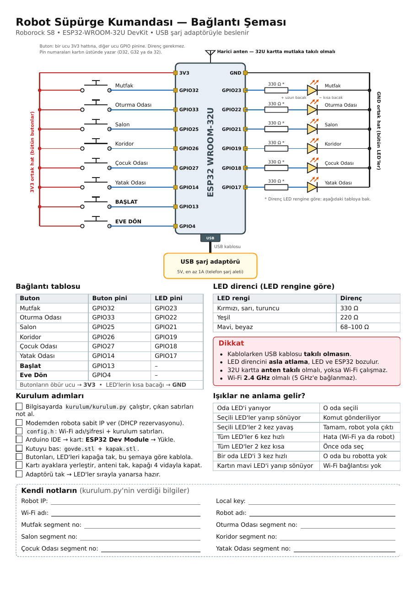
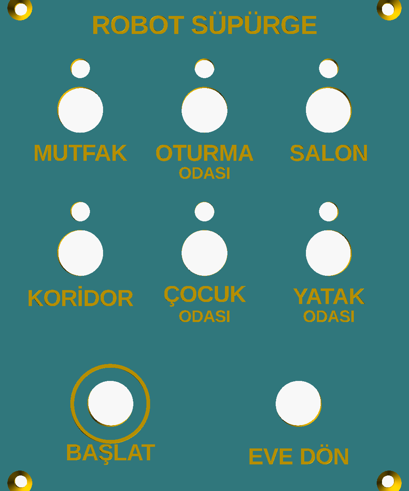

# Robot Süpürge Oda Kumandası (Roborock S8 + ESP32)

Üzerinde oda butonları olan bir kutu. Odaları seçersin, her odanın üstündeki
LED yanar, **Başlat**'a basınca robot seçtiğin odaları süpürür.

- Home Assistant **gerekmez**, bilgisayar ya da sunucu gerekmez.
- ESP32 robota **ev ağı üzerinden doğrudan** komut verir (bulutsuz, hızlı).
- Kart: **ESP32-WROOM-32U DevKit**. Güç: **USB şarj adaptörü** (telefon şarj aleti).

**Yazdırmak için bağlantı şeması:** [`semalar/baglanti_semasi.pdf`](semalar/baglanti_semasi.pdf) (tek A4 sayfa)

## Kullanım

1. Odaların butonlarına bas. Basılan odanın LED'i **yanar** (seçildi).
2. Yanlış odaya bastıysan aynı butona **tekrar bas**, LED söner (seçim kalktı).
3. **Başlat**'a bas. Robot seçili odaları süpürmeye gider.
4. **Eve Dön**'e basarsan robot ne yapıyorsa bırakır ve istasyona döner.

Kumanda prizden beslendiği için hiç kapanmaz, Wi-Fi hep bağlı kalır. Başlat'a
basınca robot hemen yola çıkar. Oda seçip 30 saniye içinde Başlat'a basmazsan
seçim kendiliğinden silinir.

| Işık | Anlamı |
|---|---|
| Oda LED'i yanıyor | O oda seçili |
| Seçili odaların LED'leri yanıp sönüyor | Komut gönderiliyor |
| Seçili odalar 2 kez yavaşça yanıp söner | Tamam, robot yola çıktı |
| Tüm LED'ler 6 kez hızlı yanıp söner | Hata (Wi-Fi'ye ya da robota ulaşılamadı) |
| Tüm LED'ler 2 kez kısa yanıp söner | Hiç oda seçmeden Başlat'a bastın |
| Bir oda LED'i 3 kez hızlı yanıp söner | O oda bu robotta tanımlı değil (`config.h`'de segment 0) |
| Kartın mavi LED'i yavaş yanıp sönüyor | Wi-Fi bağlantısı yok |
| Fişe takınca LED'ler sırayla yanıp söner | Kumanda çalışıyor |

## Malzeme listesi

| Malzeme | Adet | Not |
|---|---|---|
| ESP32-WROOM-32U DevKit (elindeki) | 1 | |
| 2.4 GHz anten (IPEX/U.FL) | 1 | 32U kartla genelde birlikte gelir. **Şart**, aşağıya bak |
| USB şarj adaptörü (5V, en az 1A) + USB kablosu | 1 | Telefon şarj aleti olur |
| Buton (12 mm, anlık / basınca kapanan) | 8 | 6 oda + Başlat + Eve Dön |
| 5 mm LED | 6 | Her odanın üstüne bir tane |
| Direnç | 6 | LED rengine göre (aşağıdaki tablo) |
| 3D baskı kutu | 1 | `kutu/govde.stl` + `kutu/kapak.stl` |
| M3 vida (10–12 mm) | 4 | Ya da 3 mm sunta vidası |
| Kablo, havya, makaron | | |

Başlat butonu için farklı renkte (örneğin yeşil) bir buton seçersen kullanımı kolaylaşır.

## Bağlantı



**Butonlar:** Bir ucu **3V3**'e, diğer ucu ESP32 pinine bağlanır. Butonlar için
direnç gerekmez, ESP32'nin içindeki dirençler kullanılıyor.

**LED'ler:** ESP32 pini → direnç → LED'in **uzun bacağı (+)**. LED'in **kısa
bacağı (−)** **GND**'ye gider.

| Oda | Buton pini | LED pini |
|---|---|---|
| Mutfak | GPIO 32 | GPIO 23 |
| Oturma Odası | GPIO 33 | GPIO 22 |
| Salon | GPIO 25 | GPIO 21 |
| Koridor | GPIO 26 | GPIO 19 |
| Çocuk Odası | GPIO 27 | GPIO 18 |
| Yatak Odası | GPIO 14 | GPIO 17 |
| **Başlat** | GPIO 13 | – |
| **Eve Dön** | GPIO 4 | – |

### LED direnci

LED'ler doğrudan ESP32 pininden beslenir, ek güç gerekmez. 6 LED'in hepsi yansa
bile toplam yaklaşık 25 mA eder. ESP32'nin bir pini ise 20 mA'i rahatça verir.
ESP32 pinleri 3.3V verdiği için direnci LED rengine göre seç:

| LED rengi | Direnç |
|---|---|
| Kırmızı, sarı, turuncu | 330 Ω |
| Yeşil | 220 Ω |
| Mavi, beyaz | 68–100 Ω (330 Ω ile çok soluk yanar) |

**Direnci asla atlama.** Dirençsiz LED hem kendini hem ESP32'nin pinini bozabilir.

### Anten (WROOM-32U)

**32U** modülünün kendi anteni yoktur. Üzerinde harici anten için küçük bir
**IPEX/U.FL** soket bulunur. **Anten takmazsan Wi-Fi çalışmaz** ya da çok zayıf kalır.

- **Çubuk anten (RP-SMA) ile:** IPEX → RP-SMA ara kablosunu modüle tak. Soketi kutunun
  **üst duvarındaki deliğe** somunuyla sabitle, anteni dışarıdan vidala.
- **Yapışkanlı ince (FPC) anten ile:** Kutunun içine, kablolardan uzak bir duvara
  yapıştır. Plastik sinyali engellemez. Bu durumda üst duvardaki delik boş kalır.

### Pinlerle ilgili notlar

- Kartın üzerindeki pin adları "D23", "G23" ya da sadece "23" diye yazılmış olabilir, hepsi aynıdır.
- Buton için **GPIO 34–39**'u kullanma, bu pinlerde dahili direnç yoktur.
- **GPIO12'yi kullanma**, basılıyken kart açılmayabilir.
- Kartın üstündeki mavi LED (GPIO2) komut gönderilirken yanar. Wi-Fi bağlantısı yoksa yanıp söner.

## 3D baskı kutu

`kutu/` klasöründe hazır baskı dosyaları var:

| Dosya | Ne |
|---|---|
| `govde.stl` | Alt kutu (112 × 140 × 52 mm) |
| `kapak.stl` | Butonların takıldığı ön panel, oda adları yazılı |
| `kutu.scad` | Düzenlenebilir tasarım (OpenSCAD) |



**Kutunun özellikleri:**
- Kapakta 6 oda butonu (12 mm), her birinin üstünde LED deliği (5 mm) ve altında oda adı yazısı var.
- Başlat butonunun etrafında halka var, kolay bulunuyor.
- Kapağın iç yüzünde her deliğin yanına **ESP32 pin numarası** yazılı. Kablolarken neyi nereye bağlayacağını oradan görürsün.
- Gövdenin içinde ESP32 için 4 ayak var. Kart, altına jumper kablo sığacak
  yükseklikte oturur. USB girişi alttaki delikten dışarı bakar, adaptör kablosu buradan takılır.
- Kart yuvası hem 30 pinli (51.5 mm) hem 38 pinli (55 mm) kartlara uyar.
- Üst duvarda RP-SMA anten soketi için delik var.
- Duvara asmak için arkada 2 anahtar deliği var (vida başı en fazla 8 mm).
- Kapak 4 adet M3 vidayla (ya da 3 mm sunta vidasıyla) kapanır.

**Baskı ayarları:** PLA ya da PETG, 0.2 mm katman, %20 doluluk. **Destek gerekmez.**
- Gövde: tabanı tablaya gelecek şekilde (dosyadaki gibi).
- Kapak: yazılı yüzü tablaya gelecek şekilde (dosya zaten öyle çevrili).
- Yazıların farklı renkte çıkmasını istersen dilimleyicide (Cura, PrusaSlicer,
  Bambu Studio) 0.8 mm'de filament değiştir.

**Ölçüleri değiştirmek için:** `kutu.scad` dosyasını ücretsiz **OpenSCAD**
programıyla aç. *Pencere → Özelleştirici* menüsünden ayarları değiştir: buton
çapı, kutu derinliği, kart ölçüsü, oda adları gibi. Sonra **F6** ile oluştur,
**F7** ile STL olarak kaydet.

> **Butonlarını almadan önce ölç:** Butonun kapak altında kalan boyu (kablo uçları
> dahil) **25 mm**'den uzunsa `buton_govde` ve `derinlik` değerlerini büyüt. Butonun
> delik çapı 12 mm değilse `buton_delik` değerini değiştir.

## Kurulum (bir kez yapılır)

### 1. Robotun bilgilerini bul (bilgisayarda, 5 dakika)

ESP32'nin robotla konuşabilmesi için üç bilgi lazım: robotun **IP adresi**,
**local key** denen şifresi ve her odanın **numarası**. Bunları `kurulum/kurulum.py`
betiği senin için bulur.

1. Bilgisayarına Python 3.11 ya da daha yenisini kur (python.org). Windows'ta
   kurarken **"Add Python to PATH"** kutusunu işaretle.
2. Komut satırını (Windows'ta "cmd") aç ve şunu yaz:

```bash
pip install python-roborock
```

3. Proje klasörüne gir ve şunu çalıştır:

```bash
python kurulum/kurulum.py
```

4. Roborock uygulamasında kullandığın e-postayı gir. E-postana gelen kodu yaz.
5. Betik robotun odalarını listeler, **yerel bağlantıyı test eder** ve
   `config.h`'ye yapıştıracağın hazır satırları ekrana yazar. Bunları A4 sayfasındaki
   "Kendi notların" bölümüne de yazabilirsin.
6. İstersen betik gerçek bir oda süpürme testi de yapar. Böylece kutuyu
   lehimlemeden önce oda numaralarının doğru olduğundan emin olursun.

> Betiği tekrar çalıştırırsan yeniden e-posta kodu istemez. Girişi `kurulum` klasöründeki
> `roborock_giris.json` dosyasına kaydeder. Kurulum bitince bu dosyayı **sil**, çünkü
> Roborock hesabına erişim anahtarı içerir.

> Oda adları Roborock uygulamasında verdiğin adlardır. Betik bunları otomatik
> eşleştirir. Eşleşmeyen satırın yanına uyarı yazar, o numarayı listeden elle yaz.

### 2. Robota sabit IP ver

Modemin arayüzüne gir (genelde 192.168.1.1) ve robot için **DHCP rezervasyonu**
yap. Böylece robotun IP adresi hiç değişmez. Bunu yapmazsan, modem yeniden
başladığında robot yeni bir IP alabilir ve kumanda çalışmayı bırakır.

### 3. ESP32'yi programla (Arduino IDE)

1. Arduino IDE 2.x'i kur (arduino.cc).
2. *Araçlar → Kart → Kart Yöneticisi*'nden **"esp32 by Espressif Systems"**
   paketini kur.
3. `RobotSupurgeKumanda/RobotSupurgeKumanda.ino` dosyasını aç. Klasördeki diğer
   dosyalar sekme olarak kendiliğinden açılır.
4. `config.h` sekmesinde şunları düzenle:
   - Wi-Fi adı ve şifresi (**2.4 GHz** ağ olmalı)
   - Kurulum betiğinin verdiği satırlar (`ROBOT_IP`, `LOCAL_KEY`, `ODALAR`)
5. Kartı seç: **"ESP32 Dev Module"**. Portu seç (*Araçlar → Port*).
6. *Yükle*'ye bas. Yükleme başlamazsa kartın üstündeki **BOOT** düğmesini
   "Connecting..." yazısı çıkana kadar basılı tut.
7. Yükleme bitince *Seri Monitör*'ü aç (115200 baud) ve bir butona bas. Ne olup
   bittiğini satır satır görürsün.

### Başka bir robota geçmek

Önce bir robotla test edip sonra asıl robota geçebilirsin. Asıl robotun olduğu evde,
o evin Wi-Fi'sine bağlı bir bilgisayarda `kurulum.py`'yi çalıştır. Çıkan `ROBOT_IP`,
`LOCAL_KEY` ve segment numaralarını `config.h`'ye yaz. Wi-Fi değiştiyse onu da yaz ve
programı tekrar yükle. Kutuya ve kablolara dokunmana gerek yok.

### 4. Kutuyu topla

1. Butonları ve LED'leri kapağa tak. LED'ler deliğe sıkı oturur, gerekirse bir damla sıcak silikon kullan.
2. Kapağın iç yüzündeki pin numaralarına ve A4 şemasına bakarak kablola.
3. ESP32'yi gövdedeki 4 ayağın üstüne oturt (USB ucu alttaki deliğe baksın). Gerekirse sıcak silikonla sabitle.
4. Anteni tak.
5. Kapağı 4 vidayla kapat.
6. Adaptörü tak. LED'ler sırayla yanarsa kumanda hazır.

## Ayarlar (`config.h`)

| Ayar | Ne işe yarar |
|---|---|
| `SECIM_ZAMAN_ASIMI_MS` | Oda seçildikten sonra bu kadar milisaniye Başlat'a basılmazsa seçim silinir (varsayılan 30000 = 30 sn) |
| `BOS_BASLAT_TUM_EV` | Oda seçmeden Başlat'a basılırsa: 1 = bütün evi süpürür, 0 = hiçbir şey yapmaz |
| `TEKRAR_SAYISI` | Her oda kaç tur süpürülsün (1–3) |
| `MESGULSE_DURDUR` | Robot o an başka bir iş yapıyorsa: 1 = durdurup yeni odalara geçer, 0 = hata verir |
| `EVE_DON_PIN` | "Eve Dön" butonunun pini. Bu butonu istemiyorsan -1 yap |
| `DURUM_LED_PIN` | Kartın mavi LED'i (2). İstemiyorsan -1 |
| `ODALAR` segment `0` | Robotun haritasında karşılığı olmayan oda: butona basınca LED'i 3 kez yanıp söner, seçilmez |
| `KUMANDA_SABIT_IP` | Varsayılan kapalı (modem otomatik IP verir). Açmak için başındaki `//` işaretini kaldır |

## Sorun giderme

| Belirti | Çözüm |
|---|---|
| Kartın mavi LED'i sürekli yanıp sönüyor | Wi-Fi'ye bağlanamıyor. Anten takılı mı? Wi-Fi adı/şifresi doğru mu? Ağ 2.4 GHz mi? Sabit IP'yi açtıysan (`KUMANDA_SABIT_IP`) kapatıp dene. |
| LED yanmıyor | LED ters takılmış olabilir. Uzun bacak (+) dirence, kısa bacak GND'ye gitmeli. |
| LED çok soluk | Mavi ya da beyaz LED'de 330 Ω büyük gelir, 68–100 Ω kullan. |
| 6 hızlı yanıp sönme, Seri Monitör'de "Robota baglanilamadi" | `ROBOT_IP` doğru mu? Robot ile ESP32 aynı ağda mı? Misafir ağı ya da "AP izolasyonu" açıksa kapat. |
| "yanit zaman asimi" | `LOCAL_KEY` yanlış olabilir. Robotu sıfırladıysan ya da uygulamaya yeniden eklediysen key değişir, `kurulum.py`'yi tekrar çalıştır. |
| Yanlış oda süpürülüyor | Haritayı yeniden oluşturduysan oda numaraları değişir. `kurulum.py`'yi tekrar çalıştır. |
| `kurulum.py` "NotImplementedError" ya da "MQTT ... timed out" hatası veriyor | Eski sürüm. Zip'teki güncel `kurulum.py`'yi kullan (Windows düzeltmesi var). |
| `kurulum.py` telefon numarasını kabul etmiyor | Sadece e-posta ile giriş yapılabiliyor. Roborock hesabına bağlı e-posta adresini yaz. |
| `kurulum.py` robotu görüyor ama "yerel bağlantı kurulamadı" diyor | Robot başka bir evde olabilir (paylaşılmış robot). Kumanda ve bu betik, robotla aynı evin Wi-Fi'sinde olmalı. |
| Odalar listesinde "(isimsiz oda)" var | Roborock uygulamasında o odaya isim verip betiği tekrar çalıştır, ya da süpürme testinde numarasını yazıp robotun nereye gittiğine bak. |
| Butona basınca tepki yok | Butonun bir ucu 3V3'e, diğeri doğru GPIO'ya mı bağlı? Seri Monitör'de "... secildi" yazısı çıkıyor mu? |

## Dosyalar

```
RobotSupurgeKumanda/
├── RobotSupurgeKumanda/          ← Arduino projesi (bu klasörü aç)
│   ├── RobotSupurgeKumanda.ino   ← ana program: butonlar, LED'ler, Wi-Fi
│   ├── config.h                  ← SENİN AYARLARIN
│   └── roborock_local.h/.cpp     ← Roborock yerel ağ protokolü
├── kurulum/kurulum.py            ← robotun IP, key ve oda numaralarını bulur
├── kutu/                         ← 3D baskı kutu (govde.stl, kapak.stl, kutu.scad)
├── semalar/                      ← A4 bağlantı şeması (yazdırmak için PDF)
└── test/                         ← testler (geliştirici için)
```

## Teknik not

Roborock S8, ev ağında **TCP 58867** portundan şifreli komut kabul eder. Bu proje
Home Assistant'ın resmi Roborock entegrasyonunun kullandığı protokolü
(python-roborock) ESP32'ye taşır. Hem eski `1.0` (AES-ECB) hem de yeni firmware'lerin
`L01` (AES-GCM) protokolünü destekler ve hangisi gerekiyorsa onu otomatik seçer.

Roborock uygulaması, programlı temizlikler ve sesli asistanlar eskisi gibi
çalışmaya devam eder, kumanda bunlara karışmaz.
